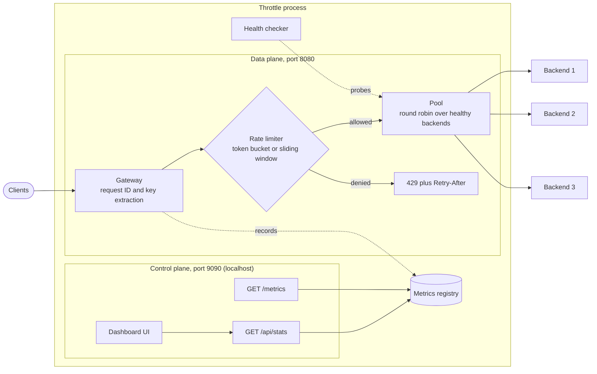
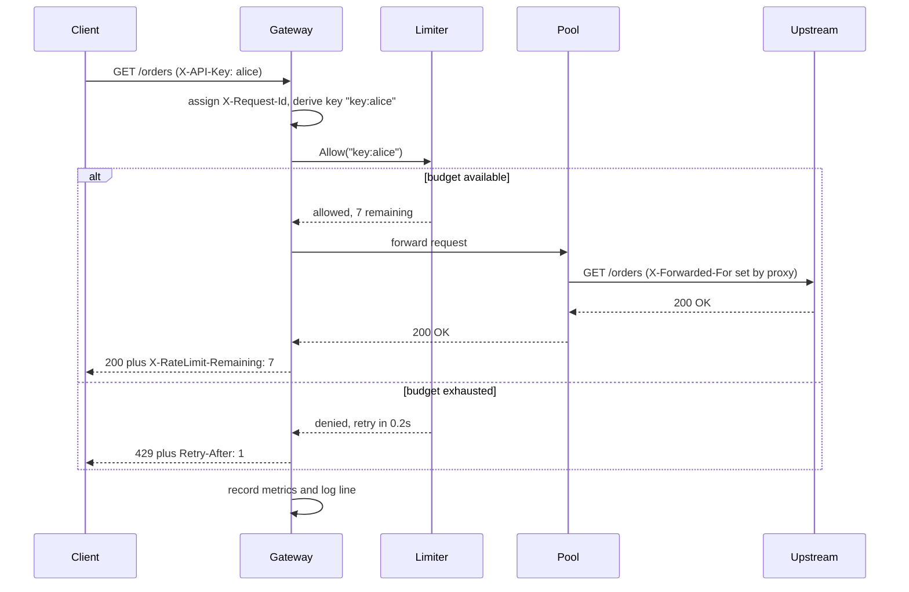

# Throttle

**A rate-limiting reverse proxy in Go, with a live dashboard.**
Zero dependencies. Standard library only.

[](https://github.com/NYMIX18/throttle/actions/workflows/ci.yml)


Throttle sits in front of your services. It identifies each caller, decides whether that caller is within their budget, and either forwards the request to a healthy upstream or answers `429 Too Many Requests` with a `Retry-After` header. A built-in dashboard shows what it is doing in real time.

```
 ┌──────────┐        ┌───────────────────────────────┐        ┌────────────┐
 │ clients  │ ─────▶ │            Throttle           │ ─────▶ │ upstream 1 │
 │ alice    │        │  identify ▸ limit ▸ balance   │ ─────▶ │ upstream 2 │
 │ bob  ... │ ◀───── │   429 when over budget        │ ─────▶ │ upstream 3 │
 └──────────┘        └───────────────────────────────┘        └────────────┘
```

## Contents

- [Why this project](#why-this-project)
- [Features](#features)
- [Quick start](#quick-start)
- [Architecture](#architecture)
- [The rate limiting algorithms](#the-rate-limiting-algorithms)
- [Concurrency design](#concurrency-design)
- [The dashboard](#the-dashboard)
- [Configuration](#configuration)
- [HTTP behaviour](#http-behaviour)
- [Testing and benchmarks](#testing-and-benchmarks)
- [Project layout](#project-layout)
- [Design decisions and trade-offs](#design-decisions-and-trade-offs)
- [Known limitations](#known-limitations)
- [Roadmap](#roadmap)

## Why this project

Every public API needs to protect itself from clients that send too much traffic, whether through a bug, a retry storm, or abuse. Rate limiting looks simple ("count requests") but has real engineering problems underneath: correctness under concurrency, memory that must not grow without bound, algorithm trade-offs, and doing all of it on the hot path of every request without slowing it down.

This project is a small, complete answer to those problems, written to be readable end to end in an afternoon.

## Features

| Area | What you get |
|---|---|
| **Algorithms** | Token bucket (allows bursts) and sliding-window counter (smooth, no boundary spikes), behind one `Limiter` interface |
| **Per-client limits** | Key by client IP or by an API-key header, with IP fallback |
| **Reverse proxy** | Round-robin load balancing across upstreams using `net/http/httputil` |
| **Health checking** | Active probes plus passive ejection on connection errors; unhealthy backends are skipped and revived automatically |
| **Standard headers** | `X-RateLimit-Limit`, `X-RateLimit-Remaining`, `Retry-After`, `X-Request-Id` |
| **Observability** | Live dashboard, JSON stats API, Prometheus `/metrics`, structured logs (`log/slog`) |
| **Concurrency** | Sharded lock design, race-detector-clean tests, benchmarks against a naive baseline |
| **Operations** | Graceful shutdown, strict config validation, Dockerfile (distroless), Compose file, CI |
| **Security** | Spoof-proof `X-Forwarded-For`, bounded memory per key space, admin on a separate localhost-only port, CSP on the dashboard |

## Quick start

You need Go 1.22 or newer.

```bash
git clone https://github.com/NYMIX18/throttle
cd throttle

make demo          # builds, then starts 3 demo backends and Throttle
```

Open the **dashboard** at <http://localhost:9090>. In a second terminal:

```bash
# one request, showing the rate limit headers
curl -i -H 'X-API-Key: me' http://localhost:8080/

# hammer it: 15 requests in a row, watch the status codes flip to 429
for i in $(seq 1 15); do
  curl -s -o /dev/null -w "%{http_code} " -H 'X-API-Key: me' http://localhost:8080/
done; echo

# or generate realistic traffic from 25 simulated clients for 20 seconds
make load
```

Prefer Docker?

```bash
docker compose up --build     # proxy on :8080, dashboard on localhost:9090
```

No terminal handy? Open the dashboard and use the **Try it** panel: it fires bursts through the real limiter and proxy from the browser.

## Architecture



Two listeners, on purpose. The **data plane** (`:8080`) carries user traffic. The **control plane** (`:9090`) serves the dashboard and metrics. Keeping them on separate ports means admin routes can never be reached through proxied traffic, and the control plane binds to `127.0.0.1` by default.

### Life of a request



Blocked requests never reach an upstream. That is the point: the limiter protects your services, and the cost of rejecting a request is one map lookup under a shard lock.

## The rate limiting algorithms

Both algorithms implement the same interface, so the gateway does not know or care which one is running:

```go
type Limiter interface {
    Allow(key string) Decision // is this caller within budget?
    Keys() int                 // how many callers have state (observability)
    Close()                    // stop background cleanup
}
```

### Token bucket (`token_bucket`)

Each key owns a bucket that holds up to `burst` tokens. The bucket refills continuously at `requests / per` tokens per second. Every request spends one token; with no token left, the request is denied.

```
   refill: 5 tokens / second
        │
        ▼
   ┌─────────┐   capacity = burst (10)
   │ ● ● ● ● │
   │ ● ● ●   │ ◀── request takes one token
   └─────────┘     empty bucket  ->  429, Retry-After = time until 1 token exists
```

Refill is computed **lazily** on each call from the elapsed time since the last call. No timer or goroutine per key, so an idle key costs nothing but a few bytes.

- **State per key:** one `float64` and one timestamp.
- **Good at:** allowing short bursts while enforcing a long-run average. This is how most real APIs want to behave.
- **Watch out for:** a client can spend a full burst instantly, so `burst` should reflect what your backend can absorb.

### Sliding window counter (`sliding_window`)

A plain fixed window ("100 requests per minute, reset on the minute") has a flaw: a client can send 100 requests at 12:00:59 and 100 more at 12:01:00, which is 200 requests in two seconds. The sliding window counter fixes that by weighting the previous window by how much of it still overlaps the window ending now:

```
estimate = previous_window_count × (1 − elapsed_fraction) + current_window_count

                 previous window            current window
              ├───────────────────────┼───────────────────────┤
 requests:            40                         10
                                  ▲ now, 25% into current window

 estimate = 40 × 0.75 + 10 = 40   →  limit 50: allowed (room for 10 more)
```

- **State per key:** two integers and a timestamp. O(1), unlike a sliding *log* that stores every timestamp.
- **Good at:** smooth enforcement with no boundary spikes.
- **Watch out for:** it assumes requests in the previous window were evenly spread, so it is an excellent approximation, not an exact count. `Retry-After` is a hint, not a guarantee.

### Choosing

| | Token bucket | Sliding window counter |
|---|---|---|
| Allows bursts | Yes, up to `burst` | No, stays close to the rate |
| Memory per key | ~16 bytes | ~24 bytes |
| Accuracy | Exact | Approximate (very close) |
| Best for | Public APIs, interactive clients | Strict quotas, billing-adjacent limits |

## Concurrency design

A rate limiter runs on **every request**, from many goroutines at once, so the data structure matters.

**The naive version** is one `map[string]*state` behind one `sync.Mutex`. It is correct, but every request from every client queues on the same lock.

**Throttle's version** splits the key space into 64 shards, each with its own mutex and map:

```
                 hash(key) % 64
   "key:alice" ─────────────────▶ shard 17 ┐
   "key:bob"   ─────────────────▶ shard 42 │  independent locks:
   "10.0.0.9"  ─────────────────▶ shard 03 │  alice and bob never
   ...                                     ┘  wait on each other
```

- The hash is an inlined FNV-1a, so choosing a shard allocates nothing.
- The critical section is a handful of arithmetic operations. No I/O, no allocation under the lock beyond first-time key creation.
- Global metrics counters are `atomic` integers, not mutex-protected.
- The sharded store is a small **generic** type (`store[T]`) shared by both algorithms.

**Memory must not grow forever.** A background janitor evicts idle keys. The idle threshold is chosen per algorithm so that eviction is *invisible* to callers:

- Token bucket: a key is only forgotten after enough time for its bucket to have refilled completely. Forgetting it earlier would hand the client a free burst.
- Sliding window: after two idle windows both counters are zero anyway.

The metrics registry also bounds its per-client table (2,048 entries, then an `(other)` bucket) because anyone can mint unlimited distinct keys.

## The dashboard

Served by the binary itself from an embedded HTML file (`//go:embed`). No build step, no JavaScript framework, no CDN, so it works offline.

```
┌──────────────────────────────────────────────────────────────────────────┐
│ Throttle  ● live          token bucket: 5 per 1s, burst 10, keyed by ... │
│                                                                          │
│ Requests   │ Allowed    │ Blocked (429)  │ Throughput │ Upstream p95     │
│ 4,812      │ 1,904      │ 2,908  60.4%   │ 187 req/s  │ 50 ms            │
│                                                                          │
│ Traffic, last two minutes                                                │
│  ▂▃▅▇█▇▆▅▆▇█▇▅▃                      allowed ▲  (drawn up)               │
│ ─────────────────────────────────── baseline ──────────────────────────  │
│  ▂▃▄▆▇▇▆▆▇▇▆▅▃                       blocked ▼  (drawn down)             │
│                                                                          │
│ Busiest clients                          │ Upstreams                     │
│ key:client-01   1,402   1,190   ████▌    │ ● 127.0.0.1:9001  healthy     │
│ key:client-02     611     402   ███      │ ● 127.0.0.1:9002  healthy     │
│ ...                                      │ ● 127.0.0.1:9003  healthy     │
│                                                                          │
│ Try it:  [alice]  [Send 10] [Burst 50] [Burst 200] [Sample traffic]      │
└──────────────────────────────────────────────────────────────────────────┘
```

The chart is deliberately **diverging**: allowed requests rise above the baseline, blocked requests fall below it. A healthy system is all blue; a client hitting its limit shows up as a red reflection underneath.

The **Try it** panel calls `POST /api/demo/burst`, which pushes synthetic requests through the real gateway in-process. Disable it with `"demo_endpoints": false`.

## Configuration

Config is a JSON file (`-config path`, default `configs/throttle.json`). Unknown fields are rejected so a typo cannot silently fall back to a default. Durations are strings like `"250ms"`, `"1s"`, `"10m"`.

```json
{
  "listen": ":8080",
  "admin_listen": "127.0.0.1:9090",
  "upstreams": ["http://127.0.0.1:9001", "http://127.0.0.1:9002"],
  "rate_limit": {
    "algorithm": "token_bucket",
    "requests": 5,
    "per": "1s",
    "burst": 10,
    "key_by": "header:X-API-Key",
    "trust_forwarded": false
  },
  "health_check": { "path": "/healthz", "interval": "3s", "timeout": "1s" },
  "shutdown_timeout": "10s",
  "demo_endpoints": true
}
```

| Field | Default | Description |
|---|---|---|
| `listen` | `:8080` | Proxy address |
| `admin_listen` | `127.0.0.1:9090` | Dashboard, `/api/stats`, `/metrics`. No auth: keep it private |
| `upstreams` | *(required)* | Backend URLs, `http` or `https` |
| `rate_limit.algorithm` | `token_bucket` | `token_bucket` or `sliding_window` |
| `rate_limit.requests` / `per` | `10` / `1s` | Long-run rate: `requests` per `per` |
| `rate_limit.burst` | `20` | Token bucket capacity (ignored by sliding window) |
| `rate_limit.key_by` | `ip` | `ip`, or `header:<Name>` (falls back to IP if the header is absent) |
| `rate_limit.trust_forwarded` | `false` | Use the first `X-Forwarded-For` entry as the client IP. **Only enable behind a trusted load balancer** |
| `health_check.path` | `/healthz` | Probed with `GET`; 2xx or 3xx means healthy |
| `shutdown_timeout` | `10s` | How long in-flight requests get to finish on SIGTERM |
| `demo_endpoints` | `true` | Enables `POST /api/demo/burst` for the dashboard |

## HTTP behaviour

Every response from the proxy carries:

```
X-Request-Id: 9f2c61d07a3b88e4
X-RateLimit-Limit: 10
X-RateLimit-Remaining: 7
```

A rejected request:

```
HTTP/1.1 429 Too Many Requests
Retry-After: 1
X-RateLimit-Limit: 10
X-RateLimit-Remaining: 0
Content-Type: application/json

{"error":"rate_limit_exceeded","retry_after_seconds":1}
```

| Situation | Response |
|---|---|
| Over budget | `429` with `Retry-After` |
| Upstream refuses or times out | `502`, and that backend leaves rotation until a probe succeeds |
| Every upstream is down | `503` |
| Client disconnects mid-request | Not counted against the upstream |

Prometheus metrics (`GET :9090/metrics`): `throttle_requests_total`, `throttle_requests_allowed_total`, `throttle_requests_blocked_total`, `throttle_upstream_errors_total`, `throttle_responses_total{class}`, and a `throttle_upstream_duration_ms` histogram.

## Testing and benchmarks

```bash
make check     # gofmt check + go vet + tests with the race detector (what CI runs)
make test      # tests only
make bench     # limiter benchmarks
```

What the tests cover:

- **Limiter correctness with a fake clock**: burst then deny, refill, burst cap, per-key isolation, sliding-window weighting, idle reset, eviction. No `time.Sleep`, so they are instant and never flaky.
- **Concurrency**: 50 goroutines race on one key; exactly `burst` requests must succeed. Run under `-race`.
- **Gateway**: 429 shape and headers, IP vs header keys, `X-Forwarded-For` trust.
- **Proxy**: round-robin distribution, unhealthy skipping, 502 on a dead upstream, recovery via health checks, spoofed forwarding headers stripped.
- **Config**: defaults, overrides, and every kind of invalid input.
- **Admin**: dashboard served with CSP, demo burst flows through the real limiter, stats reflect it.

### Benchmarks

`make bench` compares the sharded design with a deliberately naive single-mutex version under parallel load:

```
BenchmarkTokenBucket_ManyKeys
BenchmarkSlidingWindow_ManyKeys
BenchmarkNaiveSingleMutex_ManyKeys
BenchmarkTokenBucket_SingleHotKey      <- worst case: every goroutine hits one shard
```

Record your own numbers here after running them (results depend heavily on core count):

| Benchmark | ns/op | allocs/op | Notes |
|---|---|---|---|
| TokenBucket, many keys | _fill in_ | _fill in_ | sharded |
| SlidingWindow, many keys | _fill in_ | _fill in_ | sharded |
| Naive single mutex, many keys | _fill in_ | _fill in_ | baseline |
| TokenBucket, single hot key | _fill in_ | _fill in_ | worst case |

Run `go test -bench . -cpu 1,4,8 ./internal/limiter` to see how each variant scales with cores. That scaling curve is the interesting result.

## Project layout

```
throttle/
├── cmd/
│   ├── throttle/        main binary: wiring, signals, graceful shutdown
│   ├── demo-backend/    tiny upstream used by the demo
│   └── loadgen/         load generator with Zipf-distributed clients
├── internal/
│   ├── limiter/         Limiter interface, token bucket, sliding window,
│   │                    generic sharded store, janitor, tests, benchmarks
│   ├── gateway/         request pipeline: key extraction, limiting, headers, 429
│   ├── proxy/           backend pool, round robin, health checks, reverse proxy
│   ├── metrics/         lock-free counters, per-second series, Prometheus output
│   ├── admin/           dashboard (embedded HTML), /api/stats, /metrics, demo endpoint
│   └── config/          JSON config, defaults, validation
├── configs/             local demo config and Docker config
├── docs/REVIEW_GUIDE.md reading order and interview Q&A
├── scripts/             demo launcher, module rename helper
├── Dockerfile  docker-compose.yml  Makefile  .github/workflows/ci.yml
```

Dependency direction is one-way: `cmd` → `admin`/`gateway` → `proxy`/`metrics`/`limiter`. The limiter package knows nothing about HTTP, which is why it is easy to test and reuse.

## Design decisions and trade-offs

| Decision | Why | Cost |
|---|---|---|
| Standard library only | Nothing to audit or upgrade; shows the language, not a framework | Hand-rolled metrics and config instead of Prometheus client and YAML |
| `Limiter` is an interface | Swap algorithms (or a Redis-backed one) without touching the gateway | One indirect call per request, negligible |
| Lazy token refill | No goroutine or timer per key | Floating-point arithmetic on every call |
| Sharded locks over `sync.Map` | Updates are read-modify-write; `sync.Map` suits read-mostly data | 64 mutexes of fixed overhead |
| `Rewrite` instead of `Director` on `ReverseProxy` | Strips client-sent `X-Forwarded-*` before adding trustworthy ones | Requires Go 1.20+ |
| Separate admin port | Admin routes unreachable via proxied traffic | One more listener to configure |
| Injected clock in the limiter | Deterministic tests without sleeping | A function field in the store |
| Fail on unknown config fields | Catches typos at startup | Slightly stricter than most tools |
| No `WriteTimeout` on the proxy server | It would truncate slow or streaming upstream responses | Slow-client protection is limited to header and idle timeouts |

## Known limitations

Being honest about these is part of the design:

- **Single instance only.** State lives in process memory. Run two Throttle instances and each enforces its own limit, so a client effectively gets double. Scaling out needs shared state (see roadmap).
- **No persistence.** Restarting resets every client's budget.
- **`Retry-After` is a hint.** For the sliding window it is a lower bound.
- **`trust_forwarded` takes the first `X-Forwarded-For` entry.** Correct only when a trusted proxy in front overwrites that header. A multi-hop setup needs rightmost-untrusted parsing.
- **Admin port has no authentication.** It is meant for localhost or a private network.
- **No retries.** A request that hits a dead upstream gets a `502`; the next one goes elsewhere.

## Roadmap

- [ ] Redis-backed limiter (atomic Lua script) so multiple instances share budgets
- [ ] Config hot reload on `SIGHUP`
- [ ] Per-route limits (for example, a stricter limit on `/login`)
- [ ] Weighted and least-connections balancing
- [ ] Idempotent request retries to a second upstream
- [ ] Circuit breaker per backend
- [ ] OpenTelemetry tracing
- [ ] Authenticated admin endpoint

## License

MIT. See [LICENSE](LICENSE).
